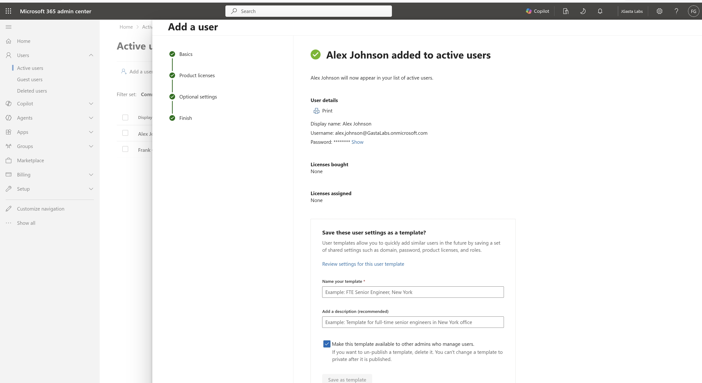

# INC0001001 — Password Reset

**Status:** Planned  
**Environment:** Dedicated Microsoft 365 test tenant (not production)  
**Ticket type:** Help desk lab

## Scenario

A fictional employee cannot sign in and requests a password reset.

## Prerequisites

- [ ] Access to a test tenant and suitable admin permissions
- [ ] Fictional test account and required trial features/licenses
- [ ] Review tenant policies and confirm the exercise is permitted

## Planned Procedure

- [ ] Find the test account in Microsoft 365 admin center or Microsoft Entra admin center
- [ ] confirm the correct identity
- [ ] reset the password using authorized admin access
- [ ] require a password change at next sign-in where supported.

## Verification Checklist

- [ ] Verify the test account can sign in with the temporary password and is prompted to change it, if configured.
- [ ] Record any errors and troubleshooting performed
- [ ] Record the final outcome and completion date

## Evidence — Account Creation

*Screenshot 1: Microsoft 365 Admin Center confirms creation of the fictional test user Alex Johnson. Account creation is complete; password reset and sign-in verification are still pending.*

## Screenshot Checklist

- [ ] User lookup (sanitized)
- [ ] password-reset option without revealing credentials
- [ ] safe verification result.

Save only redacted screenshots in a `screenshots/` folder when the lab is completed. Do not include passwords, authentication codes, real user information, or tenant secrets.

## Execution Notes

_Not started. Add actual steps, findings, and sanitized evidence after completing the lab._

## Result

**Not performed — Planned.**
