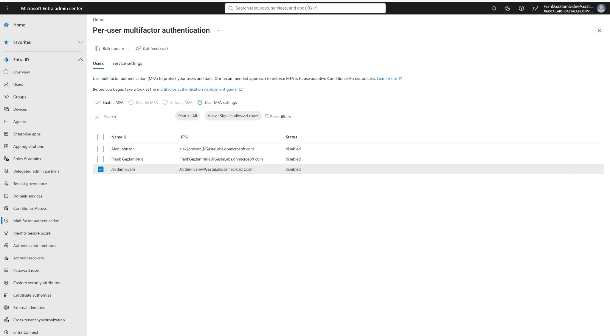
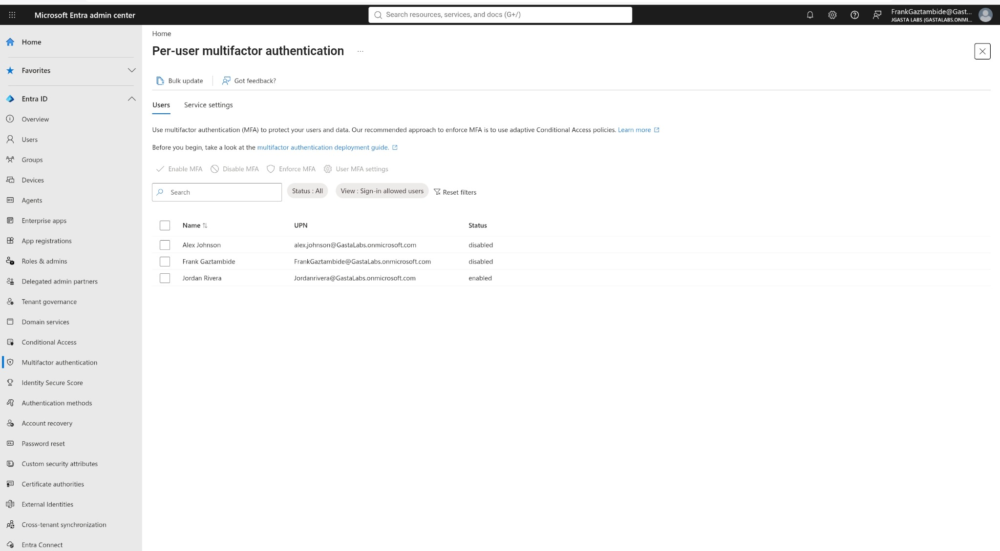
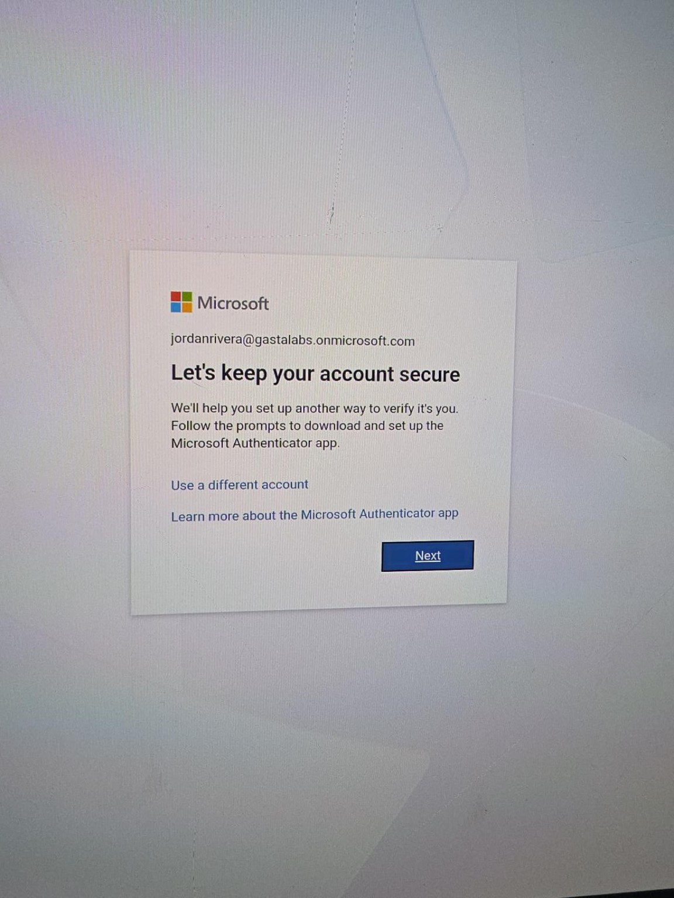
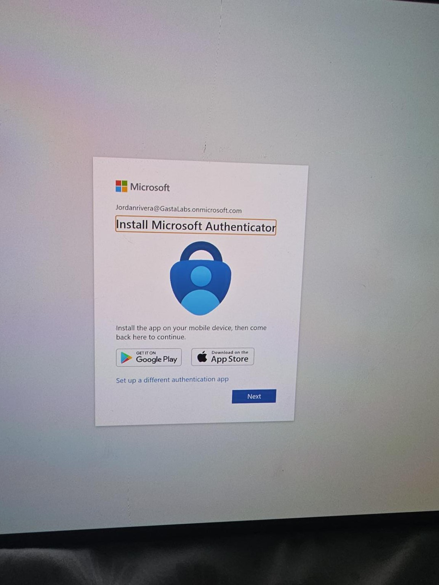
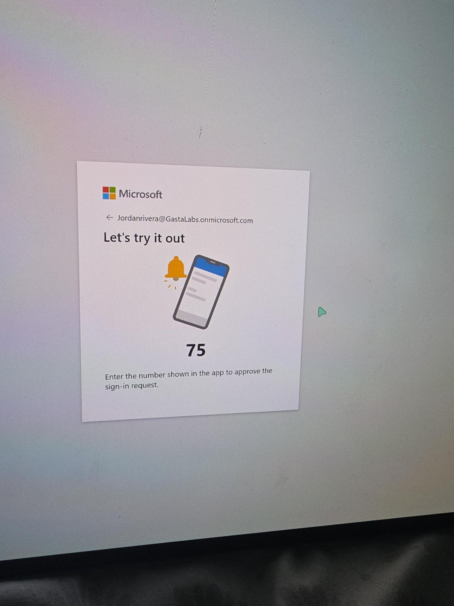
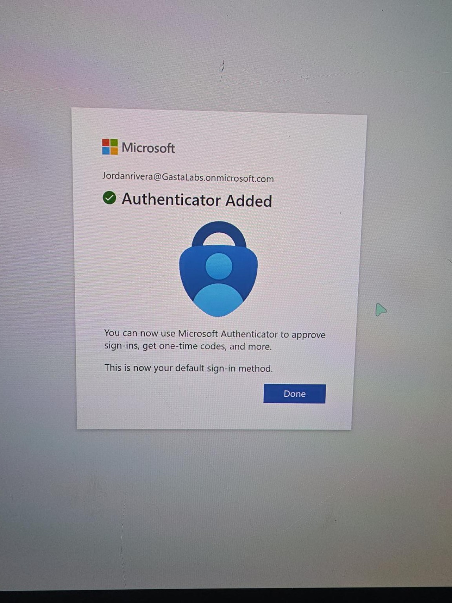
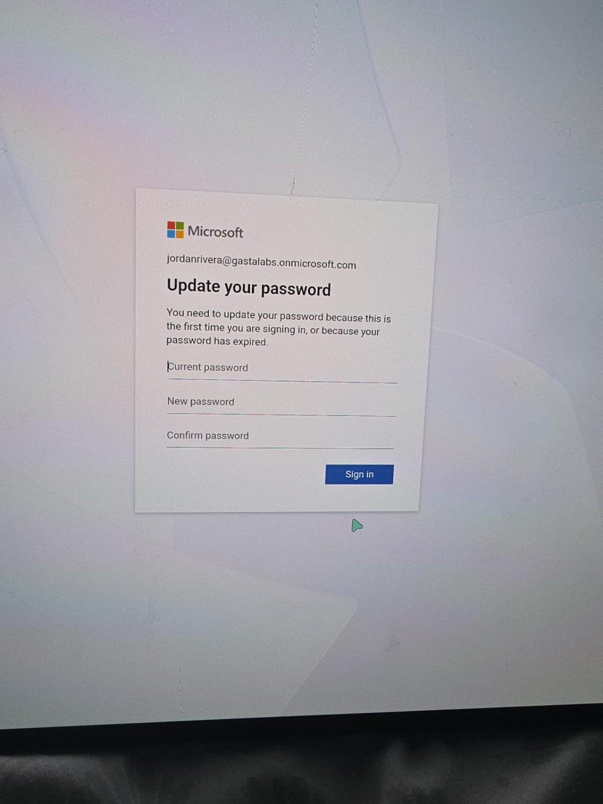
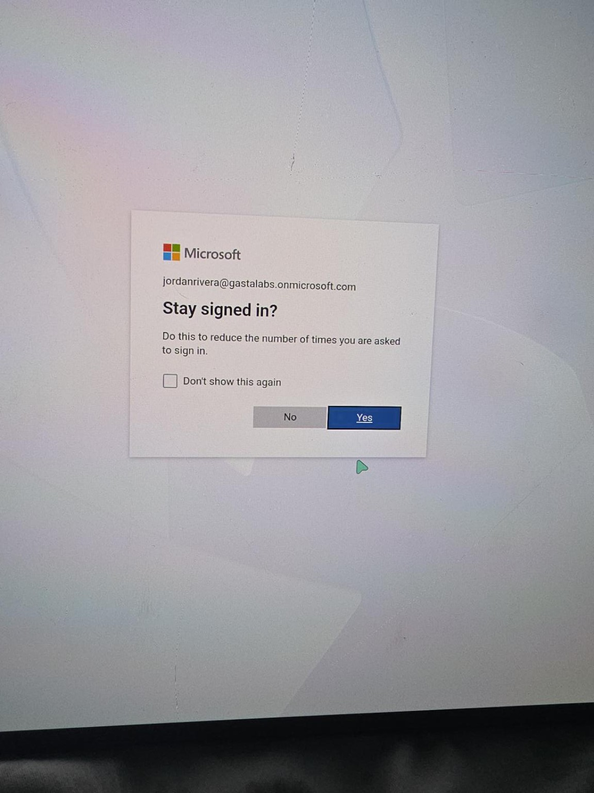
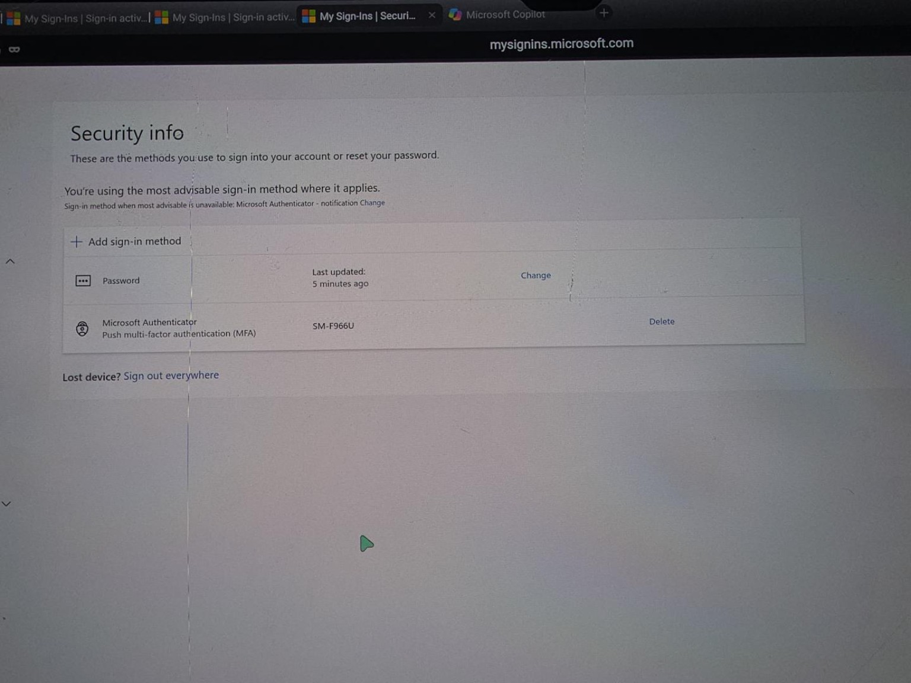

# INC0001004 — Microsoft 365 MFA Configuration

**Status:** Completed — documentation and screenshot evidence uploaded  
**Date performed:** October 28, 2026  
**Environment:** JGasta Labs — Microsoft 365 / Microsoft Entra test tenant  
**Ticket type:** Help Desk / Identity and Access Management (IAM)  
**Test user:** Jordan Rivera (fictional account)

## Ticket Scenario

A fictional employee, Jordan Rivera, requires multifactor authentication (MFA) to help protect their Microsoft 365 account. As the administrator, enable per-user MFA, guide the user through registration of Microsoft Authenticator, and verify the sign-in experience.

## Objective

- Enable MFA for the specified test user without modifying other accounts.
- Register Microsoft Authenticator as an additional sign-in factor.
- Test an MFA number-matching approval.
- Confirm the user can complete first-time account setup and sign in to Microsoft 365.
- Record the outcome using screenshots that do not expose passwords or authentication secrets.

## Environment and Tools

- Microsoft Entra admin center — per-user multifactor authentication
- Microsoft 365 test tenant (non-production)
- Microsoft Authenticator mobile application
- Microsoft My Sign-Ins / Security info
- Private browsing session for the test-user sign-in

## Procedure Performed

1. Opened **Microsoft Entra admin center → Multifactor authentication → Per-user multifactor authentication**.
2. Located and selected **Jordan Rivera**. Confirmed that the account's initial per-user MFA status was **Disabled**.
3. Selected **Enable MFA**, confirmed the change, and verified that Jordan's per-user MFA status became **Enabled**. Other listed users were not selected for this change.
4. Signed in as Jordan Rivera in a separate browser session to complete account setup and MFA registration.
5. Followed the security registration prompts and installed/opened **Microsoft Authenticator** on a mobile device.
6. Registered the test account in Microsoft Authenticator and completed the number-matching approval challenge.
7. Confirmed the **Authenticator Added** success message and that Microsoft Authenticator was available as the default sign-in method.
8. Completed the required first-sign-in password change using a new password (passwords were not captured in screenshots).
9. Completed the sign-in flow and subsequently verified that the test user could sign in to Microsoft 365.
10. Reviewed **My Sign-Ins → Security info**, which showed **Microsoft Authenticator — Push multi-factor authentication (MFA)** as a registered method.

## Verification and Results

| Check | Result |
| --- | --- |
| Per-user MFA initially disabled | Verified |
| Per-user MFA enabled for Jordan Rivera | Verified |
| Microsoft Authenticator registered | Verified |
| MFA number-matching test | Completed successfully |
| Authenticator added confirmation | Verified |
| First-time password change | Completed |
| Microsoft 365 test-user sign-in | Successful, confirmed during lab |
| Security info lists Microsoft Authenticator | Verified; screenshot uploaded |

**Outcome: Resolved — MFA configured and tested successfully for the fictional test account.**

> **Scope note:** This exercise used the legacy per-user MFA interface. Enabling per-user MFA for one test account does not demonstrate a tenant-wide Conditional Access policy or security-defaults rollout. No Conditional Access policy was created in this lab.

## Screenshot Evidence

These screenshots were captured during the hands-on lab and uploaded to the repository. Images show the configuration sequence and user enrollment. Do not upload passwords, recovery codes, QR enrollment secrets, or other sensitive information.

### 1. Initial per-user MFA status — Disabled

### 2. Per-user MFA status — Enabled

### 3. MFA registration prompt

### 4. Microsoft Authenticator setup

### 5. Number-matching verification challenge

### 6. Authenticator registration confirmation

### 7. First-sign-in password change prompt

### 8. Stay signed in prompt

### 9. Security info verification

## Skills Demonstrated

- Microsoft Entra ID user-level MFA administration
- Identity and access management (IAM)
- Microsoft Authenticator enrollment and verification
- MFA number-matching authentication
- Secure user onboarding and first-time password change
- Troubleshooting and documenting a Microsoft 365 sign-in workflow
- Help desk ticket resolution and technical documentation

## Ticket Closure Notes

**Resolution:** Enabled per-user MFA for Jordan Rivera, registered Microsoft Authenticator, completed the MFA approval test, and verified a successful Microsoft 365 sign-in. All nine supporting screenshots have been uploaded to the GitHub evidence folder.
