# INC0001007 — Shared Mailbox Configuration

**Status:** Completed — configuration and Send As email test verified  
**Environment:** JGasta Labs Microsoft 365 test tenant (non-production)  
**Ticket type:** Simulated IT service request  
**Service:** Microsoft 365 Admin Center / Exchange Online / Outlook on the web

## Scenario
A fictional IT support team needs a central mailbox so authorized support staff can access incoming messages and reply using a team identity instead of their individual email address.

## Objective
Create an IT Support shared mailbox, delegate access to Alex Johnson, and verify that an email can be sent as the shared mailbox.

## Test Resources
- **Shared mailbox display name:** IT Support
- **Shared mailbox address:** `itsupport@GastaLabs.onmicrosoft.com`
- **Delegated user:** Alex Johnson
- **Validation recipient:** Alex Johnson

## Work Performed

### 1. Review the shared mailbox inventory
In **Microsoft 365 admin center > Teams & groups > Shared mailboxes**, opened the shared mailbox list. No existing mailbox was shown in the list.

**Why:** Confirm the requested resource does not already exist before creating a duplicate.

### 2. Create the shared mailbox
Selected **Add a shared mailbox**, entered **IT Support** and the address `itsupport@GastaLabs.onmicrosoft.com`, and completed creation. The admin center displayed **Your shared mailbox was created**, and IT Support appeared in the mailbox list.

**Why:** Provide a common support address independent of any single employee's account.

### 3. Add a member
Opened **Add shared mailbox members**, selected **Alex Johnson**, and saved. The member list showed Alex Johnson with a **Saved** confirmation.

**Why:** Delegate mailbox access to an authorized test user.

### 4. Review mailbox delegation
Opened the shared mailbox permission screens. The **Read and manage permissions** screen showed Alex Johnson. The **Send as permissions** screen also showed Alex Johnson.

**Why:** These permissions serve different purposes: **Read and manage (Full Access)** allows opening and managing mailbox content; **Send As** allows a message to appear as originating from the shared mailbox. Full Access alone does not grant Send As.

### 5. Connect the mailbox in Outlook
Signed in to Outlook on the web as Alex Johnson and attempted to add the shared mailbox. Initial attempts displayed **Something went wrong** and **You don't have permission to add this account**. The mailbox had been created less than an hour earlier. A subsequent attempt displayed **Shared email account added**, and the IT Support mailbox appeared in the Outlook folder pane.

**Why:** Test the user experience and recognize that new Exchange Online mailbox/delegation changes may take time to propagate.

### 6. Test sending as IT Support
Sent a test message with subject **IT Support Shared Mailbox Test** to Alex Johnson. The received email displayed **IT Support** as the sender. Opening the sender's profile confirmed the address `itsupport@GastaLabs.onmicrosoft.com`.

**Why:** Validate the outcome from the recipient's perspective, rather than relying only on the permission configuration screens.

## Troubleshooting Notes
| Symptom | Observation / response | Outcome |
| --- | --- | --- |
| Outlook initially failed to load | Outlook displayed an error page | A later session opened successfully |
| Shared mailbox could not be added | Outlook reported a permission error shortly after setup | Retried after allowing time for changes to take effect; mailbox added successfully |
| **Show fields** was unavailable in the compose view | The control appeared disabled | Continued verification using the shared mailbox and inspected the received message's sender identity |

**Important:** The observations above do not establish a definitive root cause for the temporary Outlook errors. Permission propagation is a plausible explanation, not a confirmed diagnosis.

## Verification Checklist
- [x] Shared mailbox created and listed in Microsoft 365 admin center
- [x] Alex Johnson shown as a mailbox member
- [x] Alex Johnson shown under Read and manage permissions
- [x] Alex Johnson shown under Send as permissions
- [x] Shared mailbox added to Outlook on the web
- [x] Test message received showing IT Support as sender
- [x] Sender profile verified as `itsupport@GastaLabs.onmicrosoft.com`
- [x] Eleven original screenshots uploaded to this lab's `screenshots/` folder
- [ ] Optional cleanup / rollback documented if the test mailbox is later removed

## Screenshot Evidence

The following **11 authentic screenshots** are uploaded in [the screenshots folder](screenshots/). They document the initial setup and troubleshooting. The final screenshot shows the received test message and the shared mailbox in Outlook. A separate sender-address detail screenshot has not yet been uploaded.

### 1. Initial inventory
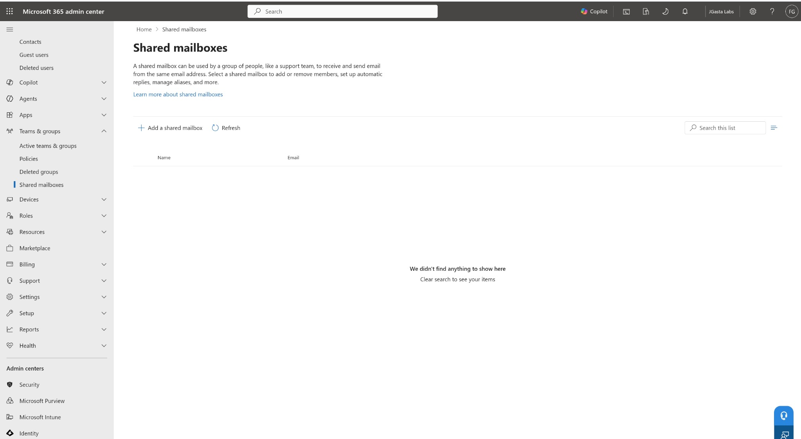

### 2. Mailbox creation
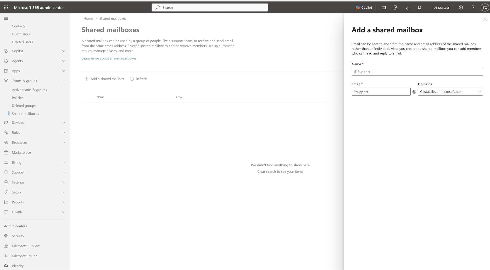
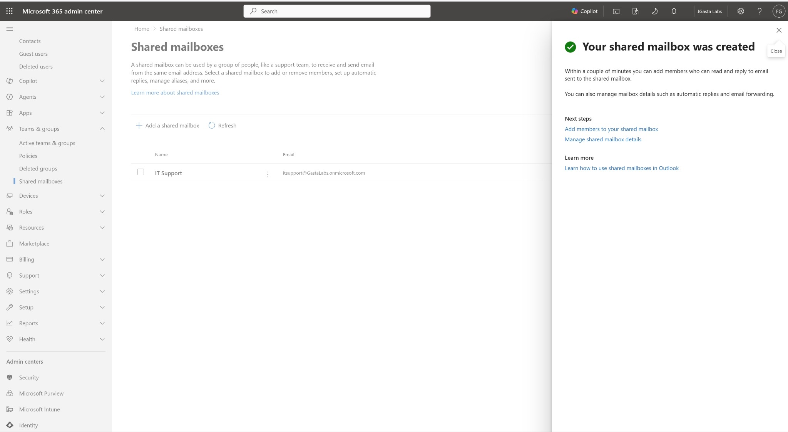

### 3. Membership
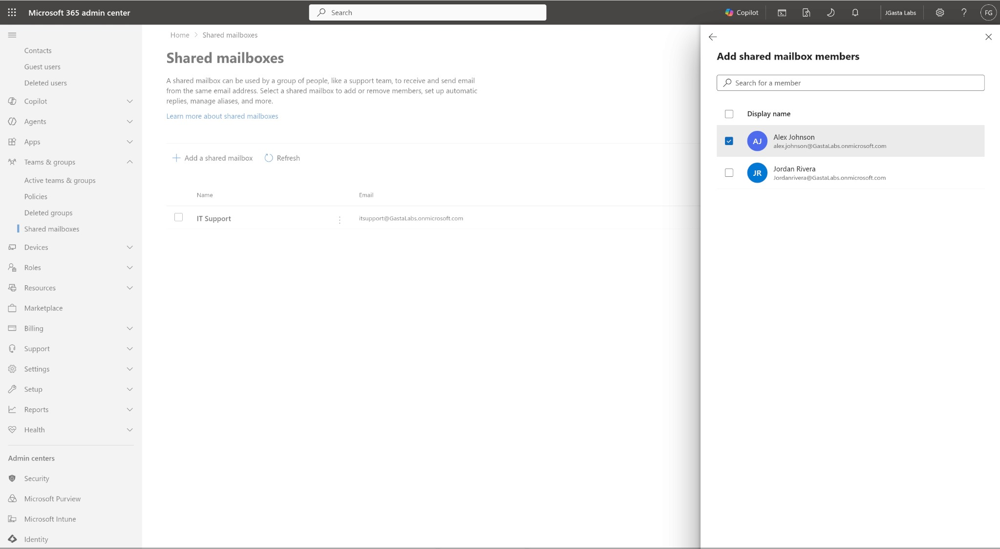
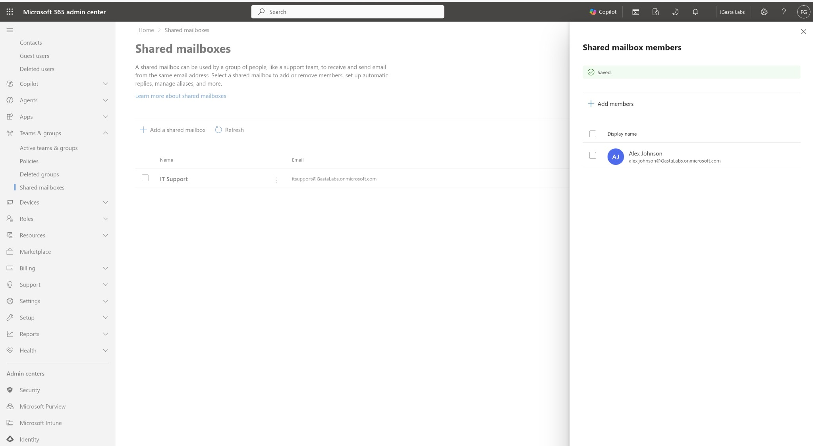

### 4. Permission verification
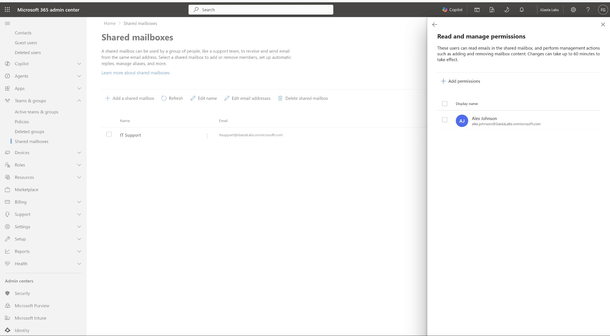
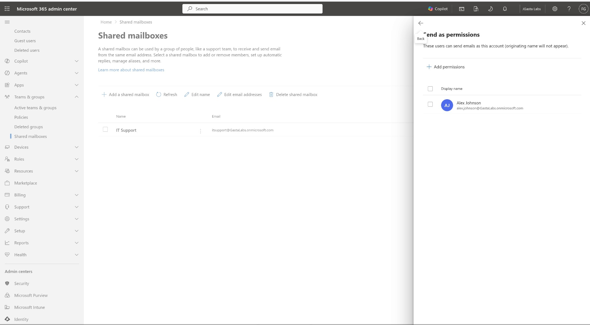

### 5. Outlook access troubleshooting
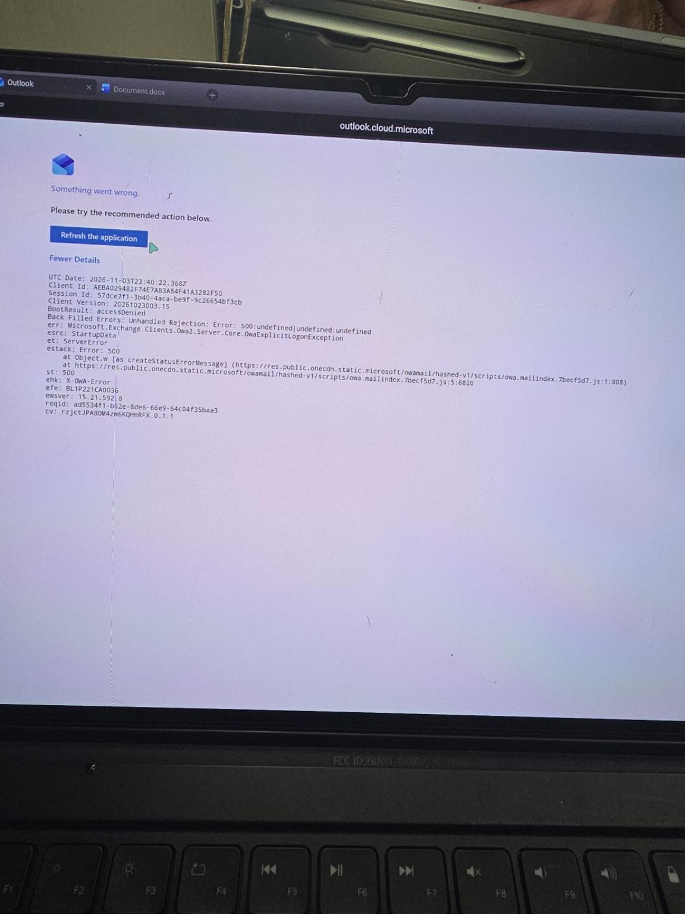
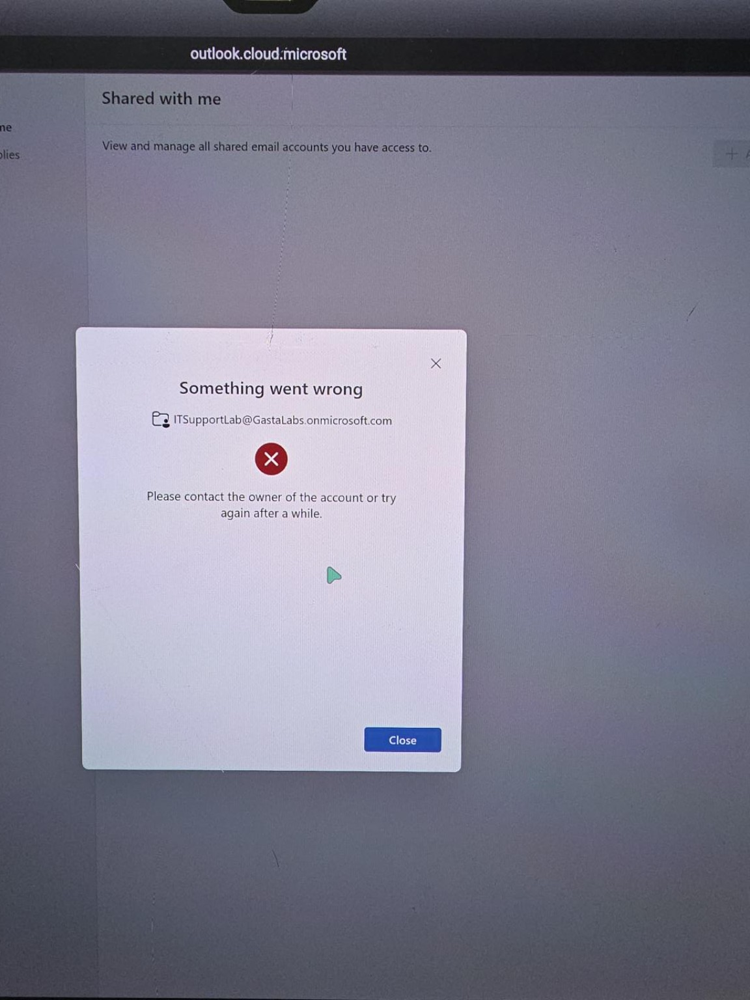
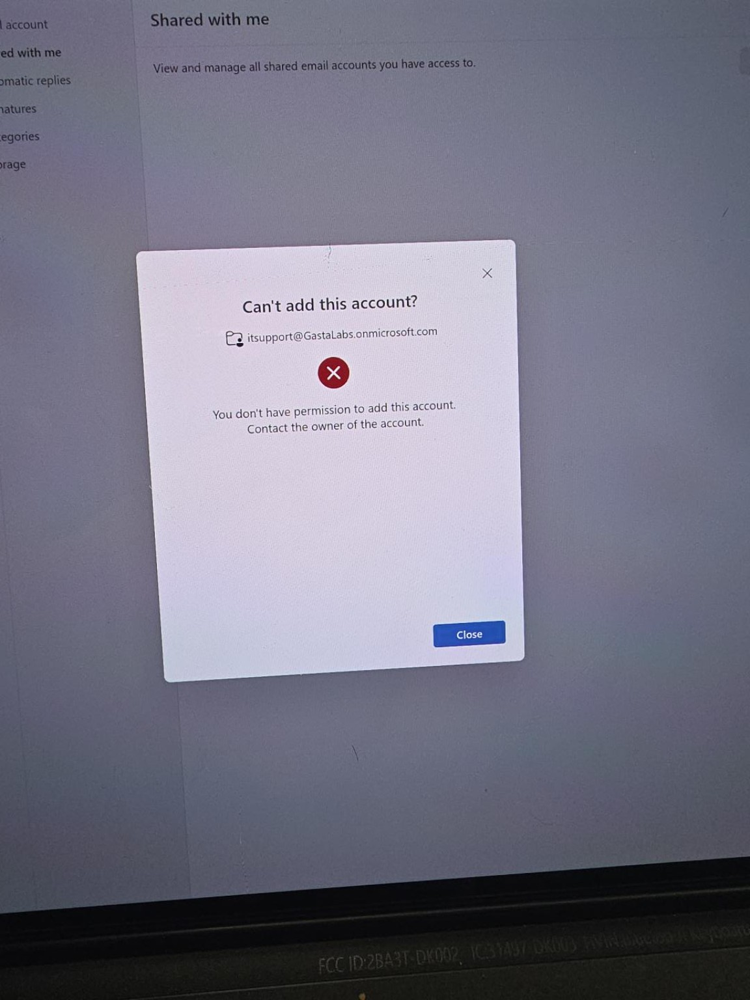

### 6. Successful test email received
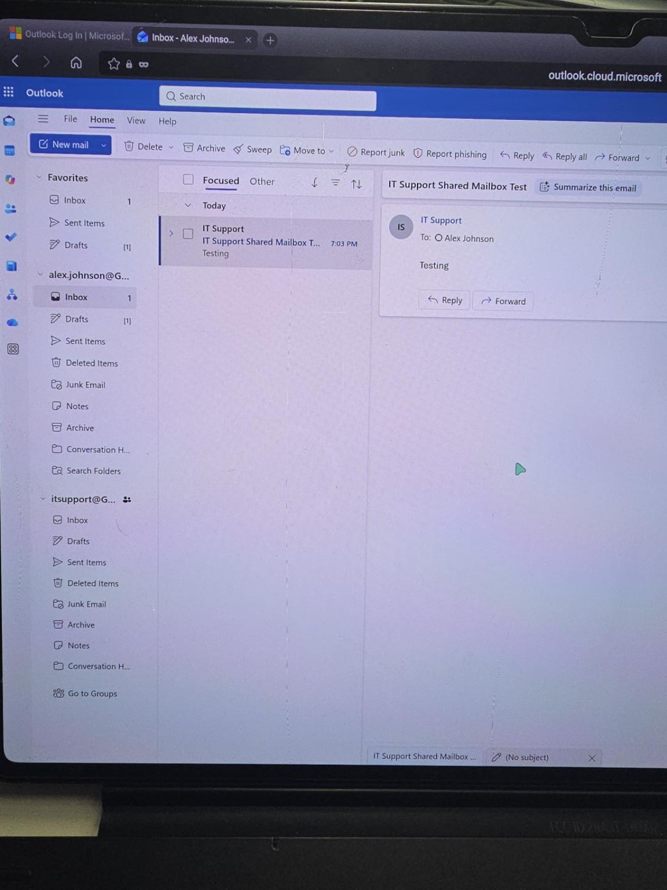

The received message displays **IT Support** as the sender, **Alex Johnson** as the recipient, and the subject **IT Support Shared Mailbox Test**. The IT Support mailbox is also visible in Outlook's folder pane. This verifies delivery and the displayed sender identity.

**Evidence limitation:** The screenshot does not display the sender's full email address. A separate sender-details screenshot would strengthen verification of the exact address.

## Skills Demonstrated
Microsoft 365 administration, Exchange Online shared mailboxes, Full Access vs. Send As delegation, Outlook on the web, permissions troubleshooting, verification, and ticket documentation.

## Result
**Completed.** Created the IT Support shared mailbox, delegated access to Alex Johnson, recovered from initial Outlook access errors, and verified successful delivery of a test message from the shared mailbox identity. Eleven screenshots are embedded above, including the received test email. A separate screenshot of the full sender address is still recommended.
